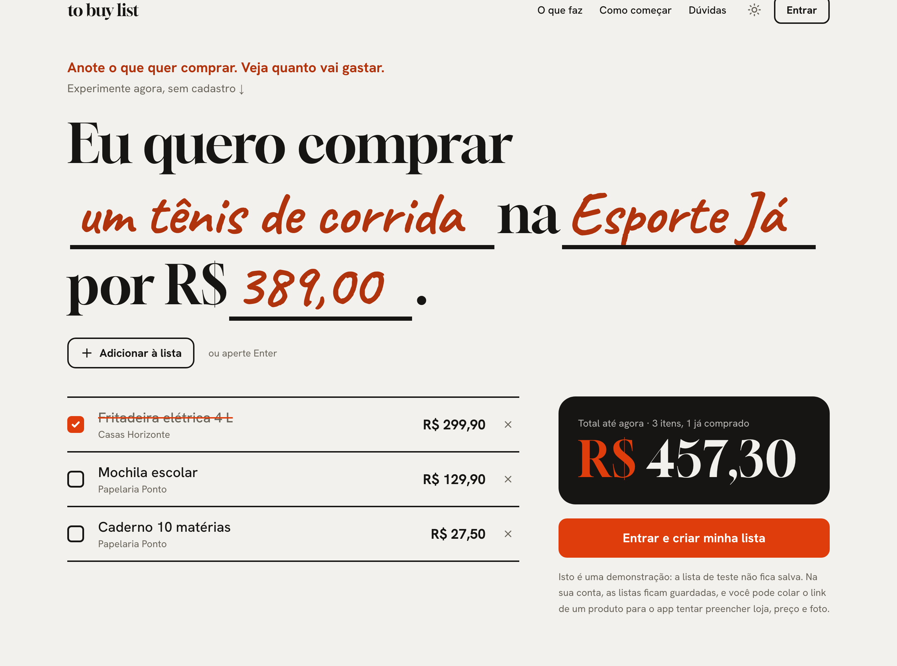

<h1 align="center">to buy list</h1>

<p align="center">
  An open source shopping list: write down what you want to buy, see how much it adds up to, and share the list with whoever is buying with you.
</p>

<p align="center">
  <a href="https://tobuylist.felps.zip"><strong>Try the live app →</strong></a>
</p>

<p align="center">
  <a href="LICENSE"></a>
  
  
  <a href="#contributing"></a>
</p>

<p align="center">
  <picture>
    <source media="(prefers-color-scheme: dark)" srcset="docs/images/landing-dark.png">
    
  </picture>
</p>

> The app itself is in Brazilian Portuguese (pt-BR) and prices are in BRL. The code, commits and docs are in English. Translations and multi-currency support would be great contributions (see [Roadmap](#roadmap)).

## Features

- **Paste a link, get the item filled in.** Drop in a product URL and the app tries to read the store page to fill in name, store, price and photo. Some stores block that, so you can always type it in and review everything before saving.
- **The total adds itself up.** Every item has a price and a quantity, and the list total sits at the top, so you know the damage before leaving the house.
- **Share a list with a link.** Choose whether the other person can only look or also edit. Anyone with the link can view it without an account; editing and saving it to their own account needs a sign-in.
- **Order by what matters.** Drag items to put the most urgent ones first.
- **Duplicate recurring lists.** Monthly groceries, school supplies, a trip: copy the list and tweak only what changed.
- **Try before you sign up.** The landing page has a working demo list (client-side only, nothing is saved).
- **A REST API for mobile clients** under `/api/mobile` (see [Mobile API](#mobile-api)).

## Tech stack

| Area | Choice |
| --- | --- |
| Framework | [Next.js 15](https://nextjs.org) (App Router, Server Components and Server Actions), React 19 |
| Auth | [Clerk](https://clerk.com) (including Google One Tap) |
| Database | [Turso](https://turso.tech) (libSQL) with [Drizzle ORM](https://orm.drizzle.team) |
| UI | Tailwind CSS, [shadcn/ui](https://ui.shadcn.com) on Radix primitives, Framer Motion, Sonner, Vaul |
| Forms and validation | React Hook Form, Zod |
| Hosting | Vercel (with Analytics and Speed Insights) |

## Running it yourself

This is the same setup for local development and for self-hosting your own instance.

### Prerequisites

- Node.js 20+ and [pnpm](https://pnpm.io)
- A [Clerk](https://clerk.com) application (the free tier is enough)
- A [Turso](https://turso.tech) database
- Optional: a [Google Programmable Search](https://programmablesearchengine.google.com) engine and API key, used to look up product images

### 1. Install

```bash
git clone https://github.com/lfals/tobuylist.git
cd tobuylist
pnpm install
```

### 2. Configure environment variables

Create a `.env.local` file in the project root:

```bash
# Clerk
NEXT_PUBLIC_CLERK_PUBLISHABLE_KEY=
CLERK_SECRET_KEY=

# Turso
TURSO_DATABASE_URL=
TURSO_AUTH_TOKEN=

# Optional: product image search
GOOGLE_API_KEY=
GOOGLE_CX_KEY=

# Optional: public URL of the site (used for canonical links, sitemap and
# Open Graph). Falls back to the Vercel production URL, then localhost.
NEXT_PUBLIC_SITE_URL=http://localhost:3000
```

`drizzle-kit` reads `.env` through `dotenv`, so if you want to run the database scripts below, keep the Turso variables in a `.env` file as well (or export them in your shell).

### 3. Set up the database

The schema lives in [`src/db/schema.ts`](src/db/schema.ts). Generate and apply the migrations:

```bash
pnpm db:generate
pnpm db:migrate
```

### 4. Run it

```bash
pnpm dev
```

Open [http://localhost:3000](http://localhost:3000).

### Deploying

The easiest path is [Vercel](https://vercel.com/new): import the repository, add the environment variables above, and deploy. Set `NEXT_PUBLIC_SITE_URL` to your production domain so canonical URLs and the sitemap point to the right place.

## Scripts

| Command | What it does |
| --- | --- |
| `pnpm dev` | Start the dev server (Turbopack) |
| `pnpm build` | Production build |
| `pnpm start` | Serve the production build |
| `pnpm db:generate` | Generate Drizzle migrations from the schema |
| `pnpm db:migrate` | Apply migrations to the database |
| `pnpm db:studio` | Open Drizzle Studio |

## Project structure

```
src/
├── app/
│   ├── page.tsx           # Public landing page
│   ├── app/               # Signed-in area: your lists and items
│   ├── s/[list]/          # Public view of a shared list
│   ├── api/mobile/        # REST API for the mobile app
│   └── llms.txt/          # Plain-text summary for LLMs, plus robots and sitemap
├── components/
│   ├── landing/           # Landing page and its live demo list
│   ├── lists/             # List, item cards, dialogs and forms
│   └── ui/                # shadcn/ui primitives
├── db/                    # Drizzle client and schema
├── services/              # Server-side logic for lists, items and access checks
└── lib/                   # Helpers (product parsing, money formatting, etc.)
```

## Mobile API

Besides the web app, the project exposes a small REST API under `/api/mobile` (lists, items, reorder, share, duplicate and product autofill from a link). Requests are authenticated with the Clerk session token sent as `Authorization: Bearer <token>`; unauthenticated calls get a `401` JSON response.

## Roadmap

There is no fixed schedule, but these are the known gaps and ideas, and good places to start if you want to help:

- [ ] Import the landing page demo list into the account after sign-in
- [ ] Run against a local libSQL database, so contributors don't need a Turso account
- [ ] Internationalization (the UI is pt-BR only today)
- [ ] Currencies other than BRL
- [ ] Automated tests (there is no test suite yet)

Have another idea? [Open an issue](https://github.com/lfals/tobuylist/issues/new) and let's talk.

## Contributing

Contributions of all sizes are welcome: bug reports, docs, translations, new features.

1. **Found a bug or have an idea?** Search the [existing issues](https://github.com/lfals/tobuylist/issues) first, then [open a new one](https://github.com/lfals/tobuylist/issues/new). For bugs, include what you did, what you expected and what happened (a screenshot helps).
2. **Want to send code?** For anything bigger than a small fix, open an issue first so we can agree on the approach before you spend time on it.
3. **Set up the project** by following [Running it yourself](#running-it-yourself).
4. **Create a branch** from `master` (for example `fix/item-quantity` or `feat/currency-support`) and keep the change focused on one thing.
5. **Check your work.** There are no automated tests yet, so run `pnpm build` to make sure the app still compiles and type-checks, and try your change in the browser.
6. **Commit with [Conventional Commits](https://www.conventionalcommits.org)**, as in the history (`feat(items): ...`, `fix(lists): ...`, `docs: ...`).
7. **Open a pull request** against `master` and describe what changed and why. Screenshots are very welcome for UI changes.

### Security

Please don't open a public issue for security problems. Report them privately through the repository's **Security** tab ("Report a vulnerability") instead.

## License

[MIT](LICENSE). You are free to use, modify and distribute this project, including for your own hosted version.
